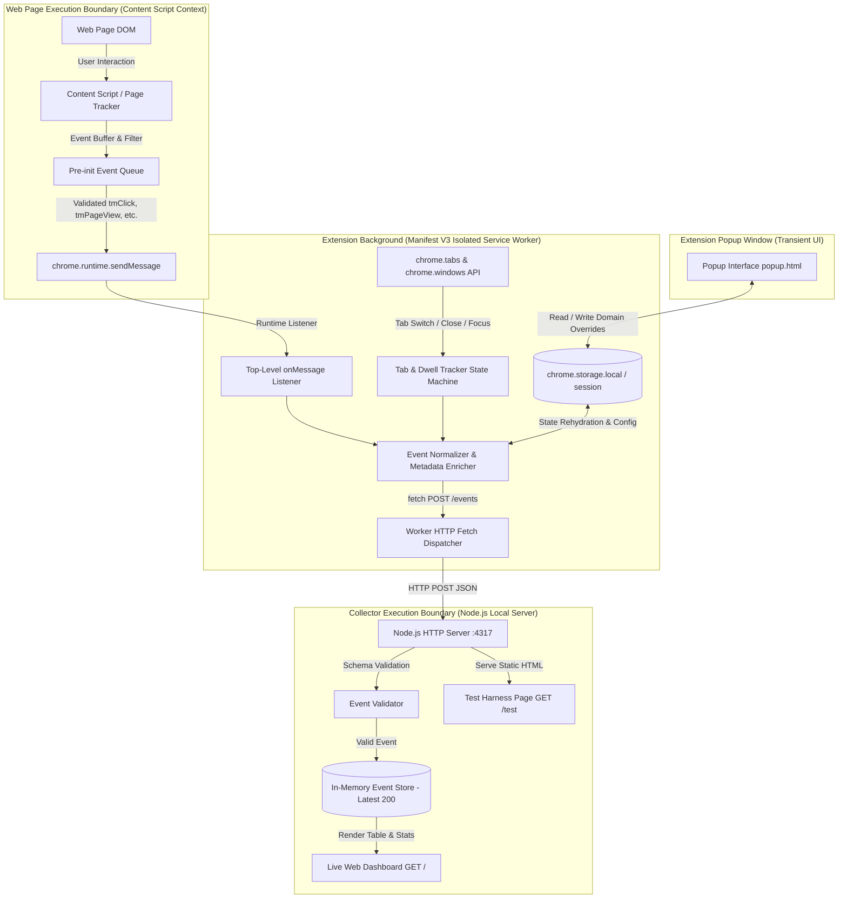
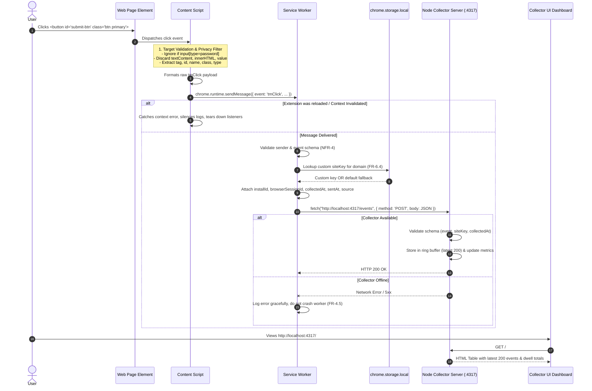

# DESIGN.md: Trailmark Architecture and System Design

## 1. System Overview and Component Architecture

Trailmark is a privacy-first Chrome Extension and analytics collector that records behavioral navigation patterns (clicks, tab switches, dwell time, scrolling, typing bursts) without capturing user input, keystroke values, page content, or full URLs.

The system is partitioned into five distinct parts across three isolated execution boundaries:



### Component Execution Boundaries

1. **Page Tracking (Content Script)**
   * **Execution Context:** Isolated world within matched web page DOMs (`host_permissions` / `matches`).
   * **Responsibility:** Captures DOM-level lifecycle and user interaction events (`tmPageView`, `tmClick`, `tmScroll`, `tmTypingBurst`). Enforces strict privacy scrubbing before events leave the page context.
   * **Isolation:** Has access to the web page DOM, but runs in an isolated execution sandbox. Page scripts cannot inspect or tamper with its internal variables.

2. **Tab Tracking & Core Dispatcher (Service Worker)**
   * **Execution Context:** Ephemeral Manifest V3 Background Service Worker (`background.js`).
   * **Responsibility:** Tracks tab activation, dwell calculation, tab closure, and browser focus/blur events. Enriches all incoming page events with unified identity metadata (`siteKey`, `installId`, `browserSessionId`, timestamps, `source`). Handles HTTP POST dispatch to the collector.
   * **Lifecycle:** Chrome stops the worker after ~30 seconds of inactivity. All listeners are registered synchronously at the root level, and critical tracking state is persisted to storage.

3. **Collector (Node.js Server)**
   * **Execution Context:** Local Node.js process (Node 18+ built-in `http` module, zero external runtime dependencies).
   * **Responsibility:** Ingests events at `POST /events`, validates schemas, maintains a ring buffer of the latest 200 events, computes aggregate metrics (dwell time per domain, event counts), serves the live management dashboard at `GET /`, and serves an interactive manual testing sandbox at `GET /test`.

4. **Popup (Extension UI)**
   * **Execution Context:** Transient HTML/JS window launched from the extension toolbar icon.
   * **Responsibility:** Displays current tab hostname, allows tenant/customer site key overrides (22-character alphanumeric format), and persists per-domain site keys via `chrome.storage.local`.

5. **Build Script & Packager**
   * **Execution Context:** Node.js CLI build pipeline (`scripts/build.js`).
   * **Responsibility:** Validates `trailmark.config.json`, enforces strict domain formatting, compiles `manifest.json` from `manifest.template.json`, injects tenant credentials, and produces development, minified production, and zip distributions.

---

## 2. Event Journey: From DOM Click to Collector

The following sequence diagram illustrates the lifecycle of a user interaction (e.g., clicking a button) traversing from the webpage to the collector dashboard:



---

## 3. Code Organization and Testability Strategy

### Directory Structure

```text
trailmark/
├── .gitignore                      # Ignores dist/, node_modules/, *.zip
├── README.md                       # Setup, collection table, test outputs, known issues
├── DESIGN.md                       # Architectural specification & decisions
├── PLAN.md                         # Milestones, daily schedule, contingency drop plan
├── package.json                    # Scripts: build, test, collector, package
├── trailmark.config.json           # Multi-tenant settings and allowed domains
├── manifest.template.json          # Manifest V3 template
├── scripts/
│   ├── build.js                    # Config validator & dist builder
│   └── package.js                  # Production zip packager
├── src/
│   ├── shared/                     # Pure JS modules (Zero Chrome API dependencies)
│   │   ├── domain-validator.js     # Validates allowedDomains formatting (FR-1.6)
│   │   ├── url-sanitizer.js        # Hostname/path extractor, stripping query/hash
│   │   ├── dwell-tracker.js        # State machine for tab dwell & blur/focus math
│   │   ├── scroll-debouncer.js     # Scroll aggregation (150ms directional debouncer)
│   │   ├── typing-debouncer.js     # Keystroke burst counter (1s threshold)
│   │   └── schema-validator.js     # Event integrity and schema validation
│   ├── content/                    # Content script execution
│   │   ├── content.js              # Entry point: lifecycle orchestration & queue
│   │   ├── click-tracker.js        # Safe click extractor
│   │   ├── scroll-tracker.js       # Scroll event listener
│   │   └── typing-tracker.js       # Typing burst listener
│   ├── background/                 # Service Worker execution
│   │   ├── background.js           # Top-level listeners & initialization
│   │   ├── tab-manager.js          # Tab activated, closed, created handlers
│   │   ├── window-manager.js       # Window focus/blur tracking
│   │   ├── event-dispatcher.js     # HTTP fetch dispatcher with failure resilience
│   │   └── state-store.js          # chrome.storage adapter for service worker rehydration
│   ├── popup/                      # Popup window
│   │   ├── popup.html              # Clean, framework-free UI
│   │   ├── popup.css               # Styling
│   │   └── popup.js                # Form handler, 22-char key validator, storage sync
│   └── collector/                  # Node.js Collector Server
│       ├── server.js               # Node http server entrypoint (port 4317)
│       ├── store.js                # Ring buffer (latest 200) & statistics aggregator
│       ├── dashboard.js            # HTML dashboard generator (XSS-safe textContent)
│       └── test-page.html          # Interactive test harness (buttons, forms, scroll areas)
└── test/                           # Automated test suite (Node test runner)
    ├── domain-validator.test.js    # Allowed domain format & tenant tests
    ├── url-sanitizer.test.js       # Hostname extraction & query string strip tests
    ├── dwell-tracker.test.js       # Dwell math, tab switching, and blur/focus pauses
    ├── scroll-debouncer.test.js    # Scroll direction and 150ms timeout tests
    ├── typing-debouncer.test.js    # Burst timing and key count tests
    ├── privacy-scrubbing.test.js   # Verifies no text, inputs, or query strings leak
    └── schema-validator.test.js    # Event schema and 400 error validation tests
```

### Pure Logic Isolation for Chrome-Independent Testing

To satisfy the testing requirement using Node's built-in test runner (`node --test`) without browser dependencies or heavy mocking:
* All calculation, timing, parsing, and aggregation logic is located in `src/shared/`.
* Modules are written as clean JavaScript classes/functions that accept state, inputs, and timestamps, returning updated states or event objects.
* For example, `DwellTracker` receives `onTabActivated(tabId, hostname, timestamp)` and `onBrowserBlur(timestamp)` calls directly; tests can simulate multi-tab switching, 300ms rapid-switching debounce, and window blurring deterministically without touching `chrome.tabs`.

---

## 4. Event Catalog & Unified Data Contract

### 4.1 Universal Shared Envelope (All Events)

Every event transmitted to the collector includes the following shared fields:

| Field | Type | Description | Example |
|---|---|---|---|
| `event` | string | Standard event name | `"tmClick"` |
| `siteKey` | string | 22-character tenant/customer site key | `"tenant_alpha_key_1234"` |
| `installId` | string (UUID v4) | Persistent unique installation ID | `"3b9c02d1-9f20-4e38-8c11-92b450143890"` |
| `browserSessionId` | string | Random string generated per browser launch | `"sess_k9f201a4e2"` |
| `collectedAt` | number | Epoch timestamp (ms) when event was recorded | `1732103400120` |
| `sentAt` | number | Epoch timestamp (ms) when dispatched to server | `1732103400150` |
| `source` | string | Originating runtime boundary: `"page"` or `"worker"` | `"page"` |

### 4.2 Page-Level Events (`source: "page"`)

#### 1. `tmPageView`
* **Trigger:** Dispatched once when content script loads in a document/frame.
* **Payload:**
  * `title`: `document.title` (string)
  * `path`: `window.location.pathname` (string, e.g. `"/settings"`)
  * `referrerHostname`: Hostname of `document.referrer` (string or empty string; query strings and paths stripped)
* **Privacy Guarantee:** Never includes `window.location.search` (`?query=...`) or `window.location.hash` (`#fragment`).

#### 2. `tmClick`
* **Trigger:** User clicks on an interactive DOM element.
* **Payload:**
  * `tag`: Element tag in uppercase (e.g. `"BUTTON"`, `"A"`, `"DIV"`)
  * `id`: Element `id` attribute (string)
  * `name`: Element `name` attribute (string)
  * `class`: Element `className` attribute (string)
  * `type`: Element `type` attribute for inputs/buttons (e.g. `"submit"`, `"text"`)
* **Privacy Guarantee:** **NEVER** includes `innerText`, `textContent`, `value`, or element content. Completely ignored if element is or is contained within `input[type="password"]`.

#### 3. `tmScroll` (Should)
* **Trigger:** Triggered when a continuous scroll sequence concludes (debounced by 150ms of inactivity or upon direction change).
* **Payload:**
  * `direction`: `"up"`, `"down"`, `"left"`, or `"right"`
  * `duration`: Duration of scroll gesture in milliseconds
  * `startPosition`: Scroll offset coordinate `[startX, startY]`
  * `endPosition`: Scroll offset coordinate `[endX, endY]`

#### 4. `tmTypingBurst` (Should)
* **Trigger:** Triggered when a sequence of keystrokes ends (inactivity > 1000ms).
* **Payload:**
  * `keyCount`: Total number of keystrokes in the burst
  * `duration`: Duration between first and last keystroke (ms)
* **Privacy Guarantee:** **NEVER** captures `event.key`, `event.code`, or input field contents. Completely ignored when typing in `input[type="password"]`.

### 4.3 Extension Background Tab & Window Events (`source: "worker"`)

#### 5. `tmTabActivated`
* **Trigger:** Active tab switch (`chrome.tabs.onActivated`).
* **Payload:**
  * `tabId`: Active tab ID
  * `hostname`: Hostname of active tab (or omitted if restricted)
  * `previousTabId`: Previous tab ID
  * `previousHostname`: Hostname of previous tab (or omitted if restricted)
  * `previousDwellMs`: Active dwell duration on the previous tab in milliseconds
  * `restricted`: `true` if previous or current tab is a restricted domain, `chrome://`, or blank tab.

#### 6. `tmTabClosed`
* **Trigger:** Tab closed (`chrome.tabs.onRemoved`).
* **Payload:**
  * `tabId`: Closed tab ID
  * `lastKnownHostname`: Last observed hostname (or omitted if restricted)
  * `isWindowClosing`: Boolean indicating if window is closing
  * `restricted`: `true` if restricted.

#### 7. `tmTabCreated` (Should)
* **Trigger:** New tab opened (`chrome.tabs.onCreated`).
* **Payload:**
  * `tabId`: Newly created tab ID
  * `openerTabId`: Tab ID of the opener tab (if initiated from an existing tab).

#### 8. `tmBrowserBlur` & `tmBrowserFocus` (Should)
* **Trigger:** Window loses/gains OS focus (`chrome.windows.onFocusChanged`).
* **Payload:**
  * `windowId`: Chrome window ID
  * `timestamp`: Epoch time of focus change
* **Dwell Math Impact:** Dwell tracking pauses on `tmBrowserBlur` and resumes on `tmBrowserFocus`. Time spent in external applications is strictly subtracted from tab dwell calculations.

---

## 5. Service Worker Lifecycle, State Persistence & Rehydration

Manifest V3 Background Service Workers are ephemeral. Chrome routinely terminates idle workers after ~30 seconds.

### 5.1 Synchronous Top-Level Listener Rule (FR-4.4)
To ensure Chrome's event dispatcher can wake up the worker upon tab switches or messages, **all event listeners are registered synchronously at the global module scope**:

```javascript
// src/background/background.js
chrome.tabs.onActivated.addListener(handleTabActivated);
chrome.tabs.onRemoved.addListener(handleTabRemoved);
chrome.tabs.onCreated.addListener(handleTabCreated);
chrome.windows.onFocusChanged.addListener(handleWindowFocusChanged);
chrome.runtime.onMessage.addListener(handleRuntimeMessage);
```

### 5.2 Storage Rehydration Strategy (FR-5.6)
To keep dwell time calculations accurate across service worker teardown and restart:
1. **State Persistence:** Whenever tab state changes (active tab switch, dwell update, blur/focus), the active dwell tracking snapshot is written to `chrome.storage.session` (in-memory persistent session storage) with fallback to `chrome.storage.local`.
   * Snapshot schema:
     ```json
     {
       "dwellState": {
         "activeTabId": 104,
         "activeHostname": "github.com",
         "activatedAt": 1732103450000,
         "accumulatedDwellMs": 4200,
         "isBlurred": false,
         "blurTimestamp": null
       },
       "knownTabs": {
         "104": { "hostname": "github.com", "restricted": false }
       }
     }
     ```
2. **Rehydration on Wake-up:** Before processing an activation or closed event, the worker loads the snapshot from storage, computes elapsed active time, and resumes tracking seamlessly.

---

## 6. Privacy & Security Architecture (NFR-1 to NFR-4)

### 6.1 Strict Privacy Boundary (NFR-1)
Trailmark enforces architectural privacy barriers in code:
1. **Password Shield:** Any element matching `input[type="password"]` or nested inside a password input container is blocked immediately:
   ```javascript
   if (element.matches('input[type="password"]') || element.closest('input[type="password"]')) {
     return; // Zero tracking
   }
   ```
2. **No Text Content or Form Values:** Clicks only extract `tag`, `id`, `name`, `class`, and `type`. Keystroke trackers only count events; `e.key` and `e.code` are never accessed or stored.
3. **No Query Parameters or URL Paths in Tab Tracking:** Tab tracking only extracts `new URL(tab.url).hostname`. Page views extract `location.pathname` and `document.title`, but discard `search` parameters and hashes.

### 6.2 Self-Documenting Privacy Audit (NFR-2)
The project documentation (`README.md`) provides a comprehensive "What Trailmark collects" disclosure table detailing every event and attribute.

### 6.3 Secure DOM Manipulation (NFR-3)
* The collector dashboard (`src/collector/dashboard.js`) and popup UI (`src/popup/popup.js`) **NEVER** use `innerHTML`, `outerHTML`, `eval()`, or `new Function()`.
* All dynamic table rows and statistics use `document.createElement()` and `element.textContent = ...` to prevent Cross-Site Scripting (XSS).

### 6.4 Event Authenticity & Schema Validation (NFR-4, FR-3.2)
* Content scripts communicate with the service worker using `chrome.runtime.sendMessage`. Page scripts cannot call `chrome.runtime.sendMessage` unless authorized via `externally_connectable` (which is omitted).
* The service worker verifies incoming message signatures and checks against allowed event types (`tmPageView`, `tmClick`, `tmScroll`, `tmTypingBurst`).
* The collector verifies that all payloads have `event`, `siteKey`, and `collectedAt`, returning HTTP 400 Bad Request for malformed requests (FR-7.2).

---

## 7. Permissions and Manifest V3 Compliance

Trailmark adheres strictly to the Principle of Least Privilege:

```json
{
  "manifest_version": 3,
  "name": "Trailmark",
  "version": "1.0.0",
  "description": "Privacy-preserving browser interaction analytics",
  "permissions": [
    "storage"
  ],
  "host_permissions": [
    "*://*/*"
  ],
  "background": {
    "service_worker": "background.js"
  },
  "content_scripts": [
    {
      "matches": ["*://*/*"],
      "js": ["content.js"],
      "all_frames": true,
      "run_at": "document_idle"
    }
  ],
  "action": {
    "default_popup": "popup.html"
  }
}
```

### Permission Justifications
* `storage`: Required to persist `installId` (UUID), per-domain site key overrides from the popup, and service worker dwell state across restarts.
* `host_permissions`: Configured dynamically from `trailmark.config.json` `allowedDomains`. Enables content script execution on target domains and allows Chrome to provide `tab.url` on those specific domains.
* **Why the `tabs` permission is NOT used (FR-5.3):**
  * The `tabs` permission grants broad, sensitive access to tab titles, URLs, and favicons across all tabs.
  * Trailmark complies with FR-5.3 by relying solely on `host_permissions`. Under Manifest V3, if a tab's URL matches `host_permissions`, `tab.url` is available without `tabs`. If the tab URL is outside `host_permissions` (e.g., `chrome://`, other unlisted websites), `tab.url` is undefined, and Trailmark correctly marks the event as `{ restricted: true }`.

---

## 8. Collector Architecture (FR-7)

Built using Node.js's native `http` module without external frameworks (FR-7.5):
* **Port:** `http://localhost:4317`
* **Endpoints:**
  * `POST /events`: Ingests JSON event payloads. Validates `event`, `siteKey`, and `collectedAt`. Returns `200 OK` or `400 Bad Request`.
  * `GET /`: Serves the live event inspection dashboard. Displays total event counts, aggregate dwell time per website, and a tabular log of the latest 200 events.
  * `GET /test`: Serves an interactive manual test harness containing buttons, text fields, password fields, and scrollable containers.
  * `GET /events/stats`: Returns JSON summary of metrics for programmatic assertions.

---

## 9. Risks, Edge Cases & Mitigation Strategies

| Risk / Edge Case | Impact | Mitigation Strategy |
|---|---|---|
| **Service Worker Teardown During Tab Dwell** | In-memory timestamps lost, dwell time reset to 0 | Store `dwellState` in `chrome.storage.session`/`local` on every tab change; recalculate on wakeup. |
| **Rapid Tab Switching (<300ms)** | Flash clicks create noise and inaccurate dwell metrics | `DwellTracker` holds events in a 300ms holding window (FR-5.7). Tabs active < 300ms are discarded. |
| **Extension Context Invalidation on Reload (FR-3.3)** | Open tabs flood console with `Extension context invalidated` errors | Wrap `chrome.runtime.sendMessage` in try/catch and inspect `chrome.runtime.id`. Silently detach listeners if context is dead. |
| **Nested Iframe Clutter (FR-2.7)** | Duplicate page views or conflicting event origins | Content script checks `window === window.top` vs `all_frames` and marks `isIframe: true` on frame events. |
| **Collector Server Unreachable (FR-4.5)** | Extension service worker could crash or freeze on failed fetch | Service worker wraps fetch in `.catch()`, logs an informative warning, and discards or safely buffers without crashing. |
| **Malformatted Allowed Domains in Config (FR-1.6)** | Extension fails to load or matches unexpected URLs | Build script runs regex validation rejecting `https://`, paths (`/home`), or leading `*.`, terminating with descriptive CLI errors. |

---

## 10. Decisions Log

### Decision 1: Pure JavaScript and Node Native Test Runner
* **Context:** Requirement mandates plain JS, Node 18+, no React, no bundler, no TypeScript.
* **Choice:** Use ES Modules / CommonJS dual-friendly modular JavaScript. Tests execute directly via `node --test test/*.test.js`.
* **Alternatives Considered:** Jest / Mocha / Vitest. Rejected because Node built-in runner eliminates third-party dependencies and aligns with assessment constraints.

### Decision 2: Decoupled State Machines for Dwell and Event Buffering
* **Context:** Dwell tracking and debouncing involve intricate timing rules that must be verified in tests without Chrome APIs.
* **Choice:** Abstract dwell math into `src/shared/dwell-tracker.js` and debouncers into `src/shared/*-debouncer.js`. The service worker and content scripts act as thin wrappers feeding browser events into these pure classes.

### Decision 3: Zero Framework Node Collector
* **Context:** Collector must run locally and display latest 200 events.
* **Choice:** Implement `http.createServer()` handling routing manually for `/events`, `/`, and `/test`.
* **Alternatives Considered:** Express / Fastify. Rejected per FR-7.5.

### Decision 4: Minification with Terser
* **Context:** FR-1.8 allows one extra package for production minification and packaging.
* **Choice:** Utilize `terser` as an optional development tool for `npm run build -- --production`.

### Decision 5: AI Coding Tools Usage
* **Context:** Requirement states AI tools may be used, provided every line can be explained during the mentor demo and disclosed in `DESIGN.md`.
* **Disclosure:** Generative AI assistant (Antigravity) was used for architectural planning, code authoring, and structuring test suites. Every line follows strict vanilla standards and is fully documented for demonstration.

